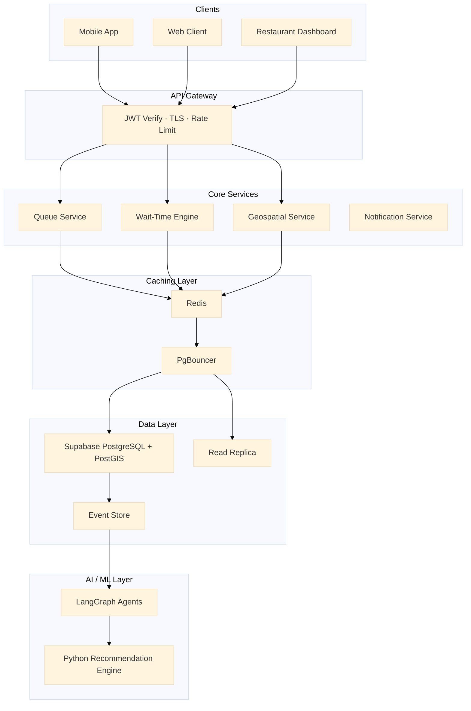

# Smart Queue & Wait-Time Prediction System Architecture

## Overview

This architecture describes a scalable, event-driven smart queue management platform designed for:
- Restaurants
- Reservation systems
- Live wait-time prediction
- Geospatial discovery
- Realtime queue synchronization
- AI-assisted queue optimization

The platform combines:
- Go/Node.js microservices
- Supabase + PostGIS
- Redis caching
- WebSocket realtime streaming
- AI/ML wait-time prediction

---

# High-Level Architecture

---

# Components

## 1. Client Layer

### Mobile App
Supports:
- Queue joining
- Live wait tracking
- Push notifications
- Geolocation updates

### Web Client
Provides:
- Restaurant discovery
- Wait-time visibility
- Booking interactions

### Restaurant Dashboard
Features:
- Queue control
- Capacity management
- Analytics
- Role-based access control

---

# 2. API Gateway

Technology:
- Go 

Responsibilities:
- JWT verification
- Rate limiting
- TLS termination
- WebSocket upgrade handling
- HMAC coordinate signing

Security features:
- Composite leaky bucket limiter
- IP + user rate limiting
- Signed geolocation packets

---

# 3. Core Services

## Queue Service
Handles:
- Queue lifecycle
- State machine transitions
- Heartbeat eviction
- Position tracking

Queue states:
- WAITING
- CONFIRMED
- ARRIVED
- SEATED
- EXPIRED
- CANCELLED

---

## Wait-Time Engine

Computes:
- Dynamic wait prediction
- Queue movement velocity
- EWMA smoothing
- Real-time adjustments

Inputs:
- Current queue depth
- Table turnover rate
- No-show probability
- Restaurant occupancy

---

## Geospatial Service

Powered by:
- PostGIS

Features:
- Nearby restaurant discovery
- Geofencing
- Radius search
- Drift tolerance

Example queries:
- Restaurants within 2 km
- ETA-aware discovery
- Queue density heatmaps

---

## Notification Service

Handles:
- Push notifications
- Queue updates
- State change events
- Realtime broadcasts

Delivery channels:
- FCM
- APNs
- WebSocket
- SSE fallback

---

# 4. Realtime Layer

## WebSocket Hub
Uses:
- Redis Pub/Sub
- Shared worker state

Supports:
- Live queue updates
- Bidirectional communication
- Multi-instance synchronization

---

## SSE Fallback
Used during:
- High load
- Mobile restrictions
- Proxy limitations

---

## Adaptive Cadence
Dynamic refresh intervals:
- Queue positions 1–2 → 15 seconds
- Queue positions 6+ → 90 seconds

---

# 5. AI / ML Layer

## LangGraph Agents

Responsibilities:
- Queue orchestration
- Wait-time adjustment
- Seasonal learning
- State transition optimization

---

## Python Recommendation Engine

Functions:
- No-show prediction
- Group-size matching
- Confidence interval calculation
- Intelligent seating optimization

---

## Analytics Pipeline

Stores:
- Immutable event logs
- Queue history
- EWMA metrics
- Time-series analytics

Used for:
- Forecasting
- Business intelligence
- Model retraining

---

# 6. Caching Layer

## Redis

Used for:
- Queue state caching
- Session storage
- Rate limiting counters
- Pub/Sub messaging
- EWMA rolling values

Data structures:
- Sorted Sets
- Hashes
- Streams
- Expiring keys

---

## PgBouncer

Purpose:
- PostgreSQL connection pooling

Benefits:
- Reduced DB overhead
- Better concurrency
- Stable connection management

---

# 7. Data Layer

## Supabase PostgreSQL + PostGIS

Stores:
- Restaurants
- Queue entries
- Table capacity
- User profiles
- Geospatial data

PostGIS features:
- Spatial indexing
- Radius queries
- Geofencing

---

## Read Replica

Handles:
- Heavy discovery queries
- Analytics reads
- Geospatial searches

Benefits:
- Reduced load on primary DB

---

## Event Store

Stores immutable:
- Queue events
- State transitions
- Analytics logs

Used as:
- Audit trail
- AI training source

---

# Infrastructure Considerations

## Horizontal Scaling

Services remain stateless using:
- Redis shared state
- Pub/Sub synchronization

Auto-scaled:
- WebSocket workers
- Queue services
- Notification workers

---

## Security

Implemented:
- JWT authentication
- HMAC coordinate signing
- TLS everywhere
- Composite rate limiting

---

## Observability

Includes:
- Distributed tracing
- Queue health metrics
- Service monitoring
- Event correlation

Recommended stack:
- OpenTelemetry
- Prometheus
- Grafana

---

# Recommended Technology Stack

| Layer | Technology |
|---|---|
| Frontend |  Svelte |
| Backend | Go (Gin/Fiber) |
| Database | Supabase PostgreSQL + PostGIS |
| Cache | Redis |
| Realtime | WebSockets + SSE |
| AI Layer | Python + LangGraph |
| Queue Broker | Redis Pub/Sub |
| Deployment | Docker + Kubernetes |
| Monitoring | Prometheus + Grafana |

---

# Scalability Goals

Designed for:
- Millions of queue events
- Realtime updates
- Low-latency geospatial queries
- Horizontal scaling
- AI-driven optimization

---

# Conclusion

This architecture combines:
- scalable microservices,
- realtime communication,
- AI-assisted wait prediction,
- geospatial intelligence,
- and resilient distributed caching

to build a production-grade smart queue ecosystem suitable for modern restaurant and hospitality platforms.
